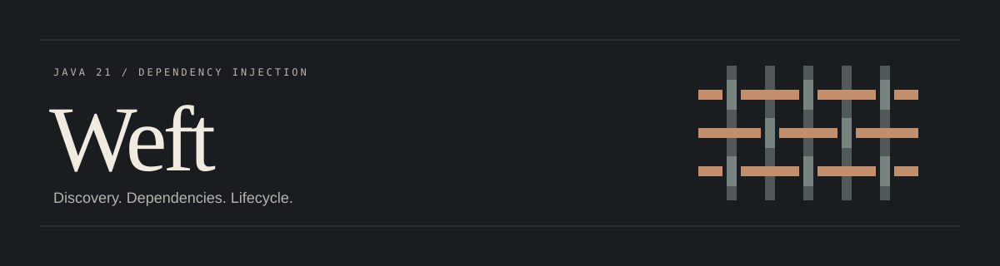

<p align="center">
  
</p>

<p align="center">
  <a href="#quick-start">Quick start</a> ·
  <a href="docs/GUIDE.md">User guide</a> ·
  <a href="#how-it-works">How it works</a> ·
  <a href="docs/LOADING.md">Host integration</a> ·
  <a href="src/test/java/com/github/ar1ls/weft/sandbox">Examples</a>
</p>

# Weft

Weft is a dependency injection container for Java 21. It discovers or accepts bean definitions, plans their dependencies before startup, and manages object creation and shutdown.

Use it to wire a standalone application or embed a container in a host that supplies its own classes and class loaders. Each runtime is independent. Source-specific defaults let a host provide a different dependency, such as a logger, to each module without naming it at every injection point.

## What it provides

- Constructor and field injection, configuration methods, and explicit registration.
- Singleton and prototype scopes, providers, and lazy interface proxies.
- Named and primary candidates, optional dependencies, and collection injection.
- Generic-aware lookup through `TypeRef`.
- Typed properties, environment conditions, and fallback beans.
- Initialization hooks, bean processors, ready events, and dependency-aware shutdown.
- Directory and JAR scanning with explicit package and class loader boundaries.

## Getting the library

Weft requires **Java 21 or later**.

Development builds use the commit version `dev-<12-character SHA>`. Stable versions such as `1.0.0` are published manually through the [Release workflow](.github/workflows/release.yml), with a JAR, sources, dependency POM, and checksums attached to a GitHub Release. See [Versions and releases](docs/RELEASING.md) for the release procedure.

There is no remote Maven repository configured. Release downloads are ordinary library artifacts, so the JAR alone does not include its dependencies. For development alongside another Gradle project, include this checkout as a subproject:

```kotlin
// settings.gradle.kts in the consuming project
include(":weft")
project(":weft").projectDir = file("../Weft")
```

```kotlin
// build.gradle.kts in the consuming module
dependencies {
    implementation(project(":weft"))
}
```

Adjust the relative path to your checkout. This uses the library's declared dependencies; copying only its JAR does not include them.

## Quick start

Explicit registration is the smallest way to start. This example fits in `Main.java` and needs no scanning or annotations:

```java
import com.github.ar1ls.weft.Weft;

public class Main {
    public static void main(String[] args) {
        try (var runtime = Weft.builder()
                .register(GreetingService.class)
                .register(GreetingText.class)
                .start()) {
            System.out.println(runtime.get(GreetingService.class).greet("Alex"));
        }
    }

    public static final class GreetingText {
        public String prefix() {
            return "Hello, ";
        }
    }

    public static final class GreetingService {
        private final GreetingText text;

        public GreetingService(GreetingText text) {
            this.text = text;
        }

        public String greet(String name) {
            return text.prefix() + name;
        }
    }
}
```

Output:

```text
Hello, Alex
```

Registration order does not determine creation order. Weft resolves the constructor dependency and creates `GreetingText` first. Closing the runtime releases the singleton resources it owns.

### Prefer annotations?

Mark top-level classes with `@Bean`, or expose factory methods from a `@Configuration` class:

```java
package example.greeting;

import com.github.ar1ls.weft.api.annotations.Bean;
import com.github.ar1ls.weft.api.annotations.Configuration;
import com.github.ar1ls.weft.api.annotations.Property;

@Configuration
public class GreetingConfiguration {
    @Bean
    public String prefix(@Property(value = "greeting.prefix", defaultValue = "Hello, ") String prefix) {
        return prefix;
    }
}
```

Scan the directory or JAR containing those classes:

```java
import com.github.ar1ls.weft.Weft;
import com.github.ar1ls.weft.definition.BeanSource;
import com.github.ar1ls.weft.discovery.ScanSource;
import java.nio.file.Path;
import java.util.List;

// GreetingConfiguration is the top-level class above.
var anchor = GreetingConfiguration.class;
var root = Path.of(anchor.getProtectionDomain().getCodeSource().getLocation().toURI());
var source = new ScanSource(root,
        new BeanSource("greeting", anchor.getClassLoader()),
        List.of("example.greeting"));

try (var runtime = Weft.builder().scan(source).start()) {
    System.out.println(runtime.get(String.class));
}
```

`register(Class, "source-id")` assigns an explicit source; `register(Class)` keeps the default `programmatic` source. Unnamed single-target dependencies prefer matching beans from their own source before using external candidates. These are explicit constructor-based singleton registrations. Use scanning for `@Configuration` methods, scope annotations, and registration conditions. The scanner skips nested classes; use top-level classes for scanned beans.

## How it works

1. **Collect definitions.** The builder combines explicit registrations, contributors, and scanned sources. Property and environment conditions filter scanned definitions.
2. **Freeze and plan.** Source defaults are expanded, fallback definitions are selected, and the registry is frozen. Weft resolves dependencies and prepares creation, property binding, and lifecycle plans. Missing or ambiguous dependencies and direct dependency cycles fail here.
3. **Start.** Eager singletons are created in dependency order. Each new managed object goes through property binding, field injection, `@PostConstruct`, and bean processors. Singleton `StartupHook` beans run before `start()` returns.
4. **Resolve on demand.** `get` returns registered beans, providers defer lookup, and prototype definitions create a new object per resolution. `create` builds an unregistered object using the running container.
5. **Close.** The runtime stops accepting external operations, waits for accepted container operations, and destroys owned singletons with consumers before their dependencies. Failed startup cleans up already-created owned singletons.

The plan is available through `runtime.report()`. Dependencies discovered only after a factory returns a more specific implementation are prepared at creation time and do not appear in that static report.

## A few rules to know

| Situation | Behavior |
| --- | --- |
| Multiple candidates | Explicit names, keys, and source defaults take precedence. Otherwise, unnamed single-target injection prefers the consumer source, then falls back to all sources; `@Primary` selects within that group. Unresolved ambiguity is an error. |
| Optional dependency | `Optional<T>` permits absence, but still rejects ambiguity. |
| Deferred dependency | `Provider<T>` works with concrete types; `@Lazy` injection requires a non-sealed interface. |
| Existing object | `inject(instance)` fills `@Inject` fields only. The caller keeps ownership. |
| Prototype or `create` result | The caller handles cleanup after successful creation. |
| Configuration method calls | Pass dependencies as method parameters. Direct calls between factory methods are ordinary Java calls. |
| Class loaders | A scan root identifies where to inspect; the supplied loader must already be able to load the classes. |

See the [user guide](docs/GUIDE.md) for configuration, selection, lifecycle, source defaults, and extension examples.

## Examples in this repository

The [sandbox](src/test/java/com/github/ar1ls/weft/sandbox) contains source examples using the public API:

- [PublicApiPlayground](src/test/java/com/github/ar1ls/weft/sandbox/PublicApiPlayground.java): scanning, properties, processors, and an independent runtime.
- [JarScanPlayground](src/test/java/com/github/ar1ls/weft/sandbox/JarScanPlayground.java): JAR discovery.
- [ModuleHostExample](src/test/java/com/github/ar1ls/weft/sandbox/loading/ModuleHostExample.java): host-supplied roots and loaders, two module implementations, shared contracts, per-source contexts, and external object injection.
- [Example beans](src/test/java/com/github/ar1ls/weft/sandbox/beans): configuration methods, qualifiers, properties, scopes, and lifecycle hooks.

These live in the test source set and use its classpath. See the [user guide](docs/GUIDE.md) for the full API walkthrough.

The [host integration guide](docs/LOADING.md) explains how to pass your existing class loader, scan one or several module JARs, and share dependencies across module boundaries. Weft requires an explicit scan root; it does not enumerate every class visible to a loader.
